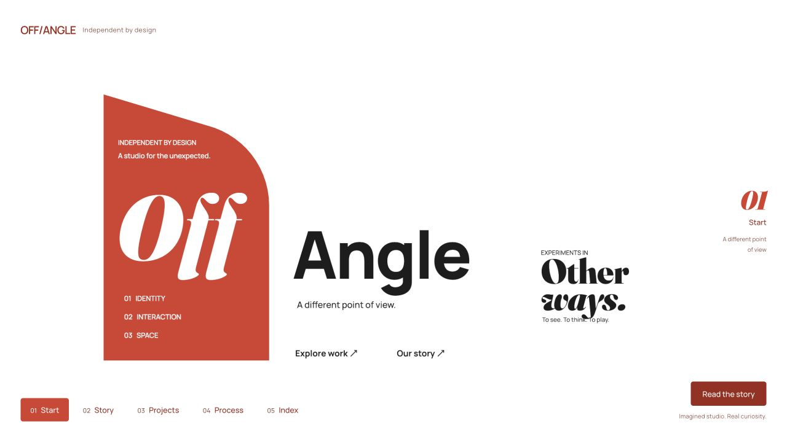
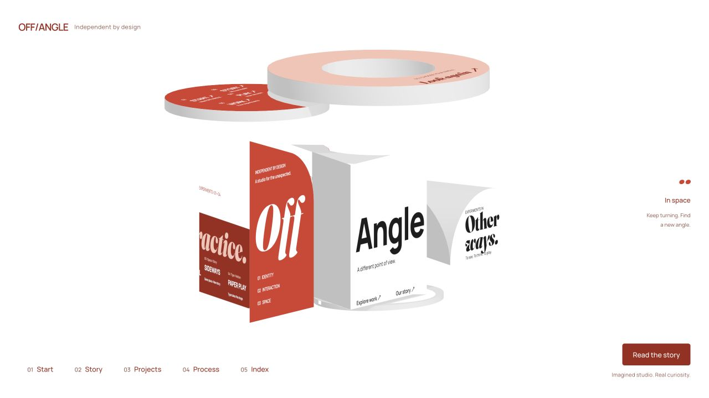

# OFF/ANGLE

A spatial website that turns one sculpture into five pages.

[Explore the live site](https://c1ayf7prewlra.space.mcode.cn/)



Drag to leave the flat composition. Rotate around the same objects to discover another page. Typography stays attached to the surfaces; camera angle and occlusion reveal each composition.



## Explore

- Drag the canvas to rotate freely.
- Scroll or select a chapter to align the next view.
- Open **Read the story** for accessible page text and project details.

OFF/ANGLE is an imagined design studio. Its four project stories are fictional examples within this interactive concept.

## Run locally

Use Node.js 20.19+ or 22.12+ (Node.js 24 is also supported).

```sh
npm ci
npm run dev
```

```sh
npm run build
npm run preview
```

Built with Three.js, Vite and JavaScript. The active scene modules live in `src/`; fonts are hosted locally in `public/fonts/`.

## Sources and licenses

The visual approach was inspired by [three-html-to-canvas](https://github.com/cullenwebber/three-html-to-canvas); no reference code or models are included. The geometry and page textures are generated in code. Font licenses are retained alongside the font files; see [THIRD_PARTY_NOTICES.md](THIRD_PARTY_NOTICES.md).

---

一个通过空间旋转组成五个页面的互动概念网站。拖动查看立体结构，滚动或点击章节重新对齐，也可以通过阅读面板查看正文。工作室及项目故事均为虚构。
